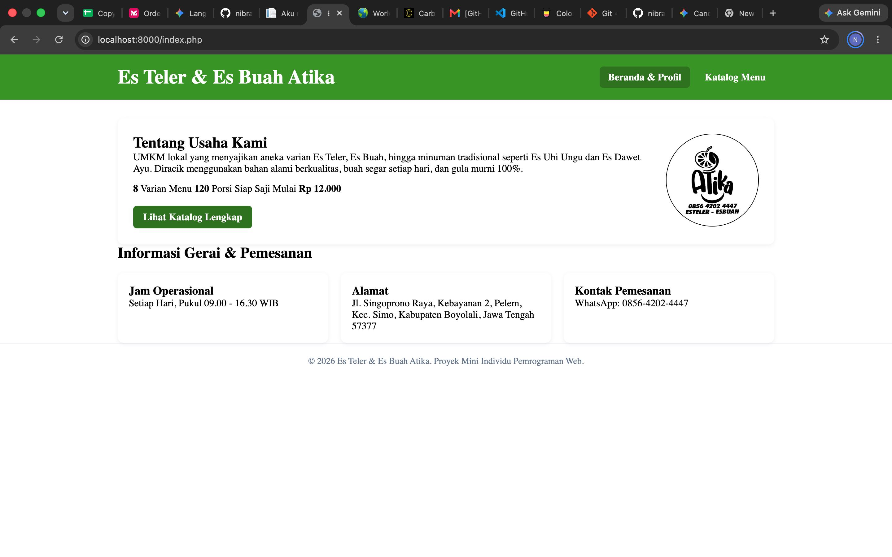
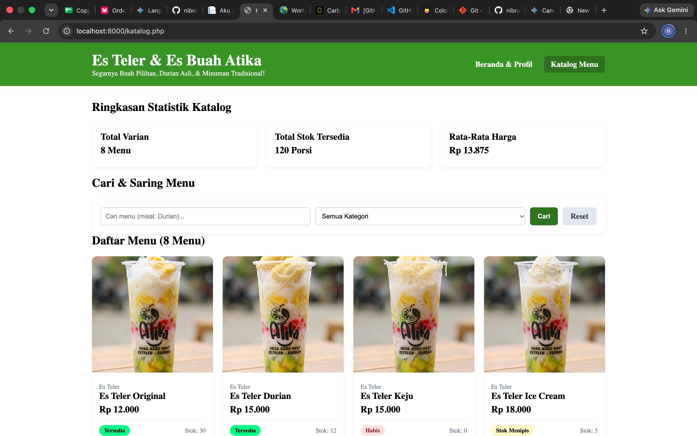

# Proyek Mini UTS Pemrograman Web — Es Teler & Es Buah Atika

Repositori ini berisi proyek mini mata kuliah **Pemrograman Web** berupa website profil usaha dan katalog menu dinamis berbasis PHP Native untuk UMKM lokal **Es Teler & Es Buah Atika**.

---

## 1. Identitas Mahasiswa
* **Nama Lengkap:** Arraul Nibras Irfandi Putra
* **NIM:** 021A00200010
* **Program Studi:** S1 Informatika
* **Mata Kuliah:** Pemrograman Web (Proyek Mini UTS)

---

## 2. Deskripsi Tema & Usaha
**Es Teler & Es Buah Atika** adalah UMKM kuliner minuman segar yang berlokasi di Jl. Singoprono Raya, Kebayanan 2, Pelem, Kec. Simo, Kabupaten Boyolali, Jawa Tengah. Usaha ini menyediakan berbagai varian Es Teler, Es Buah segar, hingga minuman tradisional seperti Es Ubi Ungu dan Es Dawet Ayu yang diracik menggunakan buah segar pilihan dan 100% gula murni.

Website ini dibangun untuk menampilkan informasi profil gerai serta katalog produk secara dinamis kepada pelanggan, lengkap dengan fitur pencarian, penyaringan (*filter*) kategori, indikator status ketersediaan stok otomatis, dan ringkasan statistik menu.

---
## 3.Cara menjalankan di localhost.
1. Simpan folder proyek uts-pemweb-025A00200010
2. Pastikan struktur file sudah sesuai.
3. Buka terminal lalu ketik php -S localhost8000
4. Buka browser, kemudian masukkan alamat berikut:http://localhost:8000
## 4. Daftar fitur 
1. **Halaman Beranda**
- File: index.php
- Menampilkan informasi umum umkm, deskripsi, ringkasan varian menu, serta informasi jam operasional, alamat gerai, dan kontak pemesanan.

2. **Navigasi Halaman**
- File: index.php, katalog.php
- Menghubungkan halaman beranda dengan halaman katalog menu.

3. **Menampilkan Daftar Menu**
- File: data.php, katalog.php
- Menyimpan dan menampilkan data menu.

4. **Filter Kategori Menu**
- File: katalog.php
- Fungsi: filterMenu(), in_array(), array_filter(), stripos()
- Menyaring daftar menu secara dinamis melalui parameter URL ($_GET) berdasarkan kata kunci nama produk dan pilihan  kategori.

5. **Informasi Statistik Ringkkasan menu**
- File: katalog.php
- Fungsi: count()
- Menghitung jumlah seluruh menu dan jumlah menu yang sedang ditampilkan.

6. **Informasi Harga Termurah**
- File: functions.php, index.php, katalog.php
- Fungsi: hitungRingkasanMenu(), count(), array_column(), array_sum()
Menghitung total varian menu, total porsi siap saji yang tersedia, dan rata-rata harga menu secara otomatis.

7. **Status Ketersediaan Stok & Warna Badge Otomatis**
- functions.php.php, katalog.php
- Fungsi: getStatusStok()
- Menentukan status stok menggunakan percabangan logika if / elseif / else serta menampilkan badge warna dinamis: Hijau (Tersedia), Kuning (Stok Menipis), dan Merah (Habis).

8. **Format Harga Rupiah**
- File: functions.php
- Fungsi: formatRupiah()
- Mengubah angka interger harga menjadi format mata uang Rupiah.

9. **Keamanan Output HTML**
- File: functions.php, index.php, katalog.php
- Fungsi: e()
- Mengamankan teks sebelum ditampilkan pada halaman HTML.

10. **Tampilan Responsif**
- File: style.css
- Mengatur tampilan website agar menyesuaikan ukuran layar laptop, tablet, dan HP.

## 5.Daftar fungsi array bawaan yang dipakai dan untuk apa.
1.count($menu): Digunakan di dalam fungsi hitungRingkasanMenu() untuk menghitung jumlah total item/. varian menu yang ada di dalam array.

2.array_column($menu, 'stok') & array_column($menu, 'harga'): Digunakan di dalam fungsi hitungRingkasanMenu() untuk mengambil satu kolom nilai spesifik (stok atau harga) dari array multidimensi menjadi array satu dimensi.

3.array_sum(...): Digunakan untuk menjumlahkan seluruh angka di dalam array hasil array_column guna mendapatkan total stok porsi siap saji dan total harga (untuk dihitung rata-ratanya).

4.min(...) & max(...): Digunakan untuk mencari nilai harga paling murah dan harga paling mahal dari array kolom harga.

5.array_filter($menu, ...): Digunakan di dalam fungsi filterMenu() untuk menyaring elemen array $daftarMenu yang sesuai dengan kata kunci pencarian dan kategori yang dipilih pengguna.

6.array_values(...): Digunakan setelah proses array_filter() untuk mengurutkan kembali indeks array mulai dari 0.

7.in_array(...): Digunakan pada katalog.php untuk memvalidasi apakah kategori yang dikirim melalui parameter URL ($_GET['kategori']) terdaftar di dalam array $daftarKategori.
## 6.Tangkapan Layar (Screenshots)

## 7.. Sumber Referensi dan Catatan Pemakaian AI
    Sumber referensi:
    pertemuan 1-6
    catatan penggunaan ai:
    diskusi untuk merapikan latar belakang foto produk kemasan cup Atika agar seragam, dan untuk perbaikan perancangan tampilan web,serta melakukan pengecekan kelengkapan syarat wajib proyek UTS.